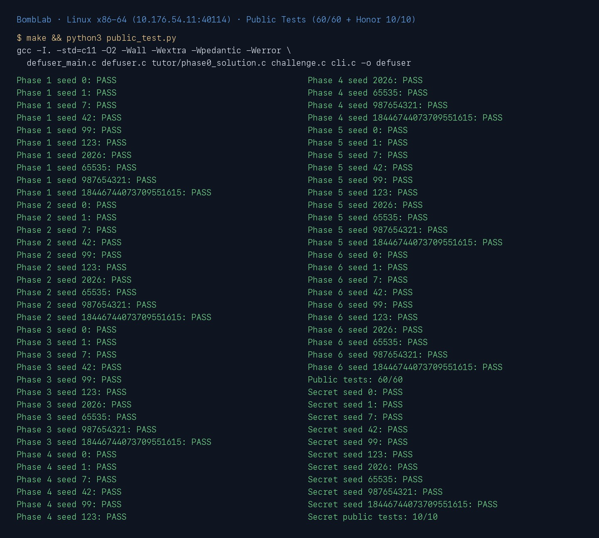
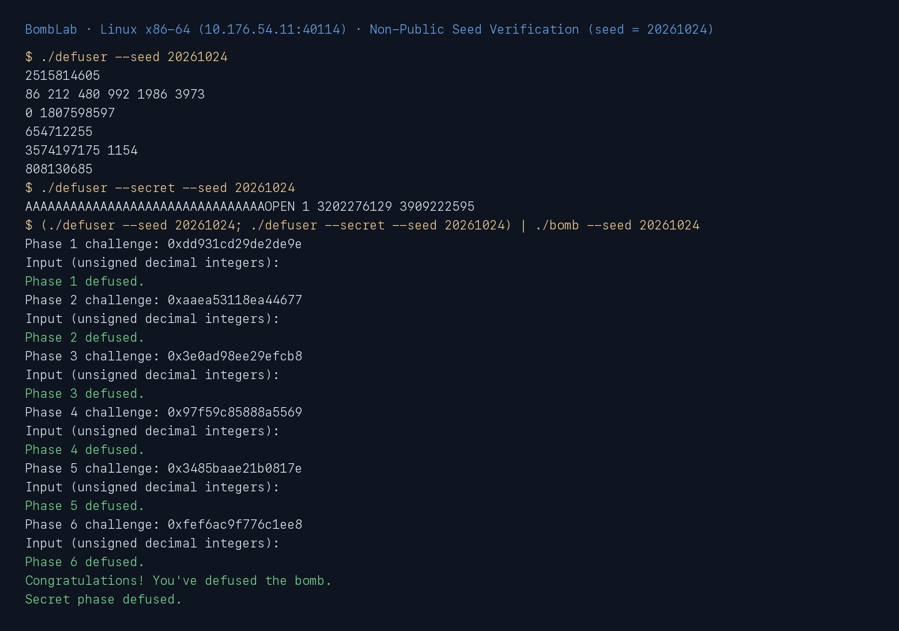

# Lab2：BombLab 实验报告

- 姓名：陈鸿基
- 学号：25803050066
- 课程：计算机系统基础（2026 年秋季）
- 个人炸弹标识：`package_id = fdb85bd7b7122b00fba54e7b`
- [实验仓库](https://github.com/realZillionX/ics-2026-bomblab)

## 一、实验环境与整体测试结果

本实验在课程提供的 Linux x86-64 服务器（Ubuntu 22.04，`Linux ics 6.8.0-57-generic x86_64`，GCC 11、GNU Make、GDB、binutils `objdump`、Python 3）上完成分析与验证。编译遵循模板 `Makefile` 的 `-std=c11 -O2 -Wall -Wextra -Wpedantic -Werror` 选项，无任何编译警告。

复现与自测命令：

```sh
make clean && make
python3 public_test.py
(./defuser --seed 20261024; ./defuser --secret --seed 20261024) | ./bomb --seed 20261024
```

公开测试中，正式关卡 Phase 1 至 Phase 6 在 10 个公开种子上共 **60/60 全部通过**，必做隐藏关 Honor（Secret Phase）在 10 个公开种子上 **10/10 全部通过**；使用公开列表以外的种子（如 `seed = 20261024`）单关测试、全流程管道测试与 GDB 断点核验亦全部通过。





---

## 二、各关卡关键汇编、计算关系恢复与推理过程

### 第 1 关（`phase_01`）：函数调用、参数传递与返回值

#### 1. 关键汇编

通过 `objdump -d ./bomb` 导出 `phase_01`、`p1_compute` 及三个辅助函数 `p1_step0`、`p1_step1`、`p1_step2`：

```asm
0000000000402020 <p1_step0>:
  402024: 81 f6 ac 0a 00 00     xor    $0xaac,%esi
  40202a: 8d 04 7e              lea    (%rsi,%rdi,2),%eax
  40202d: c3                    ret

0000000000402030 <p1_step1>:
  402034: 8d 04 77              lea    (%rdi,%rsi,2),%eax
  402037: 35 5c d1 00 00        xor    $0xd15c,%eax
  40203c: c3                    ret

0000000000402040 <p1_step2>:
  402044: 8d 04 bf              lea    (%rdi,%rdi,4),%eax
  402047: 01 f0                 add    %esi,%eax
  402049: 35 a1 e4 00 00        xor    $0xe4a1,%eax
  40204e: c3                    ret

0000000000402050 <p1_compute>:
  402055: 48 89 fa              mov    %rdi,%rdx
  402058: 48 89 f8              mov    %rdi,%rax
  40205b: 48 c1 e8 20           shr    $0x20,%rax
  40205f: 48 89 d6              mov    %rdx,%rsi
  402062: 89 c7                 mov    %eax,%edi
  402064: 48 c1 ee 10           shr    $0x10,%rsi
  40206b: e8 c0 ff ff ff        call   402030 <p1_step1>
  402070: 89 fe                 mov    %edi,%esi
  402072: 89 d7                 mov    %edx,%edi
  402074: 89 c1                 mov    %eax,%ecx
  402076: e8 a5 ff ff ff        call   402020 <p1_step0>
  40207b: 89 ce                 mov    %ecx,%esi
  40207d: 89 c7                 mov    %eax,%edi
  40207f: e8 bc ff ff ff        call   402040 <p1_step2>
```

#### 2. 推理过程与计算关系

1. **输入格式**：`phase_01` 先以 `esi = 1` 调用 `valid_u32_fields`，再用 `sscanf(input, "%u", &v0)` 读取 **1 个** 32 位无符号整数，并与 `p1_compute(challenge)` 的返回值 `%eax` 比较（`4020e0: cmp %eax, -0x14(%rbp)`）。
2. **三段切片与分步调用**（均按 `uint32_t` 模 $2^{32}$ 运算）：
   - 记 $w_0 = \text{ uint32\_t }(\text{challenge})$，$w_1 = \text{ uint32\_t }(\text{challenge} \gg 16)$，$w_2 = \text{ uint32\_t }(\text{challenge} \gg 32)$。
   - 第一次调用 `p1_step1(w2, w1)`：计算 $s_1 = (w_2 + 2 w_1) \oplus \text{0xd15c}$。注意 `p1_step1` 未修改 `%edi`（仍为 $w_2$）与 `%edx`（仍为 $w_0$）。
   - 第二次调用 `p1_step0(w0, w2)`：返回值保存在 `%eax`，同时 $s_1$ 保存在 `%ecx` 中未被破坏，计算得 $s_0 = (w_2 \oplus \text{0x0aac}) + 2 w_0$。
   - 第三次调用 `p1_step2(s0, s1)`：`lea (%rdi,%rdi,4), %eax` 计算 $5 s_0$，加上 $s_1$ 后异或 `0xe4a1`，最终口令为：
     $$\text{ans} = (5 s_0 + s_1) \oplus \text{0xe4a1}$$

---

### 第 2 关（`phase_02`）：数组、循环与递推关系

#### 1. 关键汇编

```asm
  4020fd: be 06 00 00 00        mov    $0x6,%esi
  ...
  40215a: 4c 89 e8              mov    %r13,%rax        # rax = challenge
  40215d: 8b 75 c0              mov    -0x40(%rbp),%esi # esi = v[0]
  402160: 48 c1 e8 29           shr    $0x29,%rax       # challenge >> 41
  402164: 01 c0                 add    %eax,%eax        # * 2
  402166: 25 fe 01 00 00        and    $0x1fe,%eax      # & 0x1fe
  40216b: 83 c0 04              add    $0x4,%eax        # + 4
  40216e: 39 c6                 cmp    %eax,%esi
  402170: 75 a3                 jne    402115 <phase_02+0x25>
  402172: b9 12 00 00 00        mov    $0x12,%ecx       # shift = 18
  402177: ba 01 00 00 00        mov    $0x1,%edx        # i = 1
  40217c: 4c 89 e8              mov    %r13,%rax
  40217f: 48 d3 e8              shr    %cl,%rax
  402182: 83 e0 3f              and    $0x3f,%eax
  402185: 31 d0                 xor    %edx,%eax
  402187: 8d 04 70              lea    (%rax,%rsi,2),%eax
  40218a: 8b 74 95 c0           mov    -0x40(%rbp,%rdx,4),%esi
  40218e: 39 c6                 cmp    %eax,%esi
  402190: 75 83                 jne    402115 <phase_02+0x25>
  402192: 48 83 c2 01           add    $0x1,%rdx
  402196: 83 c1 04              add    $0x4,%ecx
  402199: 48 83 fa 06           cmp    $0x6,%rdx
  40219d: 75 dd                 jne    40217c <phase_02+0x8c>
```

#### 2. 推理过程与计算关系

1. **输入格式**：`valid_u32_fields` 和 `sscanf` 读取 **6 个** 32 位无符号整数 `v[0..5]`，存放在栈帧 `-0x40(%rbp)` 至 `-0x2c(%rbp)`。
2. **首项计算**：`challenge >> 41` 左移 1 位并与 `0x1fe` 相与（等价于取低 8 位再乘以 2），再加 4：
   $$v_0 = (((\text{challenge} \gg 41) \mathbin{\&} \text{0xff}) \times 2) + 4$$
3. **递推关系**：循环变量 $i = \text{\%rdx}$ 从 $1$ 遍历到 $5$，移位量 $\text{shift} = \text{\%ecx}$ 初值为 `0x12`（18），每轮递增 4（即 $\text{shift}_i = 18 + 4(i-1)$）：
   $$v_i = 2 v_{i-1} + \bigl(((\text{challenge} \gg (18 + 4(i-1))) \mathbin{\&} \text{0x3f}) \oplus i\bigr), \quad i = 1, 2, 3, 4, 5$$

---

### 第 3 关（`phase_03`）：`switch` 分支与跳转表

#### 1. 关键汇编与 `.rodata` 跳转表

```asm
0000000000402250 <p3_dispatch>:
  402254: 89 f8                 mov    %edi,%eax
  402256: 89 f7                 mov    %esi,%edi
  402258: 83 f8 07              cmp    $0x7,%eax
  40225b: 77 45                 ja     4022a2 <p3_dispatch+0x52>
  40225d: 3e ff 24 c5 20 58 40  notrack jmp *0x405820(,%rax,8)
  402264: 00 
  402268: eb a6                 jmp    402210 <p3_case_5>
  402270: eb ae                 jmp    402220 <p3_case_6>
  402278: e9 63 ff ff ff        jmp    4021e0 <p3_case_2>
  402280: e9 2b ff ff ff        jmp    4021b0 <p3_case_0>
  402288: e9 63 ff ff ff        jmp    4021f0 <p3_case_3>
  402290: e9 6b ff ff ff        jmp    402200 <p3_case_4>
  402298: e9 33 ff ff ff        jmp    4021d0 <p3_case_1>
  4022a0: eb 9e                 jmp    402240 <p3_case_7>
```

导出 `.rodata` 节 `0x405820` 处的 8 个 64 位小端序跳转地址：

```text
405820: 78224000 00000000 80224000 00000000   # [0]=0x402278, [1]=0x402280
405830: 88224000 00000000 90224000 00000000   # [2]=0x402288, [3]=0x402290
405840: 98224000 00000000 a0224000 00000000   # [4]=0x402298, [5]=0x4022a0
405850: 68224000 00000000 70224000 00000000   # [6]=0x402268, [7]=0x402270
```

#### 2. 推理过程与计算关系

1. **输入格式**：读取 **2 个** 32 位无符号整数 `v[0]`、`v[1]`。
2. **第一个数 `v[0]`**：`402301: and $0x7, %edi; cmp %edi, -0x18(%rbp)`，故 $v_0 = \text{challenge} \mathbin{\&} 7$。
3. **第二个数 `v[1]`**：传入 `p3_dispatch(op, x)` 的第二个参数为 $x = \text{uint32\_t}(\text{challenge} \gg 32) \oplus \text{uint32\_t}(\text{challenge} \gg 3)$。注意跳转表 `0x405820` 中的分支下标 `0..7` 并非按名字顺序对应 `p3_case_0..7`，实际映射关系如下表所示：

| 分支 `op` | 跳转表目标地址 | 实际调用的辅助函数 | 对应的 32 位无符号计算表达式 |
| :---: | :---: | :---: | :--- |
| `0` | `0x402278` | `p3_case_2` | $5x + \text{0xa588}$ |
| `1` | `0x402280` | `p3_case_0` | $(4x) \oplus \text{0xbd13}$ |
| `2` | `0x402288` | `p3_case_3` | $5x + \text{0xccce}$ |
| `3` | `0x402290` | `p3_case_4` | $(x \oplus \text{0x2801}) + (x \gg 1)$ |
| `4` | `0x402298` | `p3_case_1` | $(x \oplus \text{0xb783}) + (x \gg 1)$ |
| `5` | `0x4022a0` | `p3_case_7` | $5x + \text{0x04d3}$ |
| `6` | `0x402268` | `p3_case_5` | $5x + \text{0x3820c}$ |
| `7` | `0x402270` | `p3_case_6` | $(4x) \oplus \text{0x33f5}$ |

---

### 第 4 关（`phase_04`）：递归调用与返回过程

#### 1. 关键汇编

```asm
0000000000402330 <p4_walk>:
  402334: 89 f8                 mov    %edi,%eax        # eax = target
  402336: 89 d7                 mov    %edx,%edi        # edi = high
  402338: 29 f7                 sub    %esi,%edi        # high - low
  40233a: d1 ef                 shr    $1,%edi          # (high - low) >> 1
  40233c: 01 f7                 add    %esi,%edi        # edi = mid = low + ((high - low) >> 1)
  40233e: 39 c7                 cmp    %eax,%edi        # mid == target ?
  402340: 74 4e                 je     402390 <p4_walk+0x60>
  ...
  402347: 8d 1c 0f              lea    (%rdi,%rcx,1),%ebx # ebx = mid + key
  40234e: 39 f8                 cmp    %edi,%eax        # compare target with mid
  402350: 72 1e                 jb     402370 <p4_walk+0x40> # jump if target < mid
  402352: 8d 77 01              lea    0x1(%rdi),%esi   # low = mid + 1
  402355: 89 c7                 mov    %eax,%edi
  402357: e8 d4 ff ff ff        call   402330 <p4_walk>
  40235c: 8d 04 40              lea    (%rax,%rax,2),%eax # * 3
  40235f: 31 d8                 xor    %ebx,%eax        # ^ (mid + key)
  ...
  402366: 83 f0 1b              xor    $0x1b,%eax       # ^ 0x1b
  402369: c3                    ret
  402370: 8d 57 ff              lea    -0x1(%rdi),%edx  # high = mid - 1
  402373: 89 c7                 mov    %eax,%edi
  402375: e8 b6 ff ff ff        call   402330 <p4_walk>
  40237a: 8d 04 40              lea    (%rax,%rax,2),%eax # * 3
  40237d: 31 d8                 xor    %ebx,%eax        # ^ (mid + key)
  ...
  402384: 83 f0 17              xor    $0x17,%eax       # ^ 0x17
  402387: c3                    ret
  402390: 8d 87 d0 00 00 00     lea    0xd0(%rdi),%eax  # mid + 0xd0
  402396: 31 c8                 xor    %ecx,%eax        # ^ key
  402398: c3                    ret
```

#### 2. 推理过程与计算关系

1. **输入参数**：`phase_04` 读取 **1 个** 整数，调用 `p4_walk(target, 0, 127, key)`，其中：
   - $\text{target} = \text{uint32\_t}(\text{challenge}) \mathbin{\&} \text{0x7f}$
   - $\text{key} = \text{uint32\_t}(\text{challenge} \gg 7) \oplus \text{uint32\_t}(\text{challenge} \gg 32)$
2. **二分递归关系**：设 $\text{mid} = \text{low} + ((\text{high} - \text{low}) \gg 1)$：
   - **基例**（$\text{target} = \text{mid}$）：返回 $(\text{mid} + \text{0xd0}) \oplus \text{key}$；
   - **左子树**（$\text{target} < \text{mid}$，`jb 402370`）：递归计算 $r = \text{p4\_walk}(\text{target}, \text{low}, \text{mid}-1, \text{key})$，返回 $((3r) \oplus (\text{mid} + \text{key})) \oplus \text{0x17}$；
   - **右子树**（$\text{target} > \text{mid}$）：递归计算 $r = \text{p4\_walk}(\text{target}, \text{mid}+1, \text{high}, \text{key})$，返回 $((3r) \oplus (\text{mid} + \text{key})) \oplus \text{0x1b}$。

---

### 第 5 关（`phase_05`）：结构体布局、指针与链表遍历

#### 1. 关键汇编与 `.rodata` 链表节点布局

```asm
0000000000402420 <p5_traverse>:
  40242d: 83 e0 07              and    $0x7,%eax
  402430: 48 c1 e9 03           shr    $0x3,%rcx
  402434: 48 8b 14 c5 60 5b 40  mov    0x405b60(,%rax,8),%rdx
  40243b: 00 
  40243c: 48 89 f8              mov    %rdi,%rax
  40243f: 48 c1 ef 20           shr    $0x20,%rdi
  402443: 48 c1 e8 06           shr    $0x6,%rax
  402447: 31 f8                 xor    %edi,%eax
  402449: 8b 72 08              mov    0x8(%rdx),%esi
  40244c: 89 cf                 mov    %ecx,%edi
  40244e: 35 dc 62 00 00        xor    $0x62dc,%eax
  402453: 03 42 0c              add    0xc(%rdx),%eax
  402456: 8d 04 80              lea    (%rax,%rax,4),%eax
  402459: 41 89 30              mov    %esi,(%r8)
  40245c: 31 f0                 xor    %esi,%eax
  40245e: 83 e7 03              and    $0x3,%edi
  402461: 74 1d                 je     402480 <p5_traverse+0x60>
  402463: b9 01 00 00 00        mov    $0x1,%ecx
  402468: 48 8b 12              mov    (%rdx),%rdx
  40246b: 83 c1 01              add    $0x1,%ecx
  40246e: 8b 72 08              mov    0x8(%rdx),%esi
  402471: 03 42 0c              add    0xc(%rdx),%eax
  402474: 8d 04 80              lea    (%rax,%rax,4),%eax
  402477: 41 89 30              mov    %esi,(%r8)
  40247a: 31 f0                 xor    %esi,%eax
  40247c: 39 cf                 cmp    %ecx,%edi
  40247e: 73 e8                 jae    402468 <p5_traverse+0x48>
  402480: c3                    ret
```

#### 2. 推理过程与计算关系

1. **结构体布局**：由 `mov (%rdx), %rdx`、`mov 0x8(%rdx), %esi`、`add 0xc(%rdx), %eax` 可知每个链表节点占 16 字节：
   - 偏移 `0x0`（8 字节）：`next` 指针；
   - 偏移 `0x8`（4 字节）：`uint32_t tag`；
   - 偏移 `0xc`（4 字节）：`uint32_t val`。
2. **静态链表还原**：读取 `.rodata` 中 `p5_heads`（`0x405b60`）与 `p5_nodes`（`0x405ba0`）的数据，12 个节点构成一条单链表（且 `p5_heads[0..7]` 恰好指向该链表的前 8 个节点）：
   `0x405ba0 (tag=0x0125, val=0x7964)` → `0x405c30 (0x0816, 0x1daf)` → `0x405c40 (0x0a10, 0xe5c2)` → `0x405be0 (0x0001, 0x7ab6)` → `0x405c00 (0x093b, 0x3598)` → `0x405bd0 (0x050a, 0xb590)` → `0x405c10 (0x0309, 0x8c86)` → `0x405bc0 (0x0b5f, 0x1004)` → `0x405c50 (0x021f, 0xe3ea)` → `0x405bf0 (0x0482, 0x7663)` → `0x405c20 (0x0714, 0xa6b3)` → `0x405bb0 (0x065a, 0x2998)` → `NULL`。
3. **遍历与折叠计算**：
   - 起始下标 $\text{head\_idx} = \text{challenge} \mathbin{\&} 7$，额外前进步数 $\text{steps} = (\text{challenge} \gg 3) \mathbin{\&} 3$；
   - 初始累加器 $\text{acc} = (\text{uint32\_t}(\text{challenge} \gg 6) \oplus \text{uint32\_t}(\text{challenge} \gg 32)) \oplus \text{0x62dc}$；
   - 依次访问链表中下标为 $\text{head\_idx} + s$（$s = 0, 1, \dots, \text{steps}$）的节点，每次更新：
     $$\text{acc} \leftarrow ((\text{acc} + \text{node.val}) \times 5) \oplus \text{node.tag}, \quad \text{last\_tag} \leftarrow \text{node.tag}$$
   - 输出 **2 个**整数：`values[0] = acc`，`values[1] = last_tag`。

---

### 第 6 关（`phase_06`）：函数指针表与间接调用

#### 1. 关键汇编与函数指针表 `p6_ops`

```asm
0000000000402570 <p6_dispatch>:
  402579: 48 89 fb              mov    %rdi,%rbx
  40257c: 48 c1 ef 06           shr    $0x6,%rdi
  402580: 48 89 d8              mov    %rbx,%rax
  402583: 48 c1 e8 20           shr    $0x20,%rax
  402587: 31 c7                 xor    %eax,%edi
  402589: 48 89 d8              mov    %rbx,%rax
  ...
  402590: 83 e3 38              and    $0x38,%ebx
  402593: 83 e0 07              and    $0x7,%eax
  402596: ff 14 c5 00 5e 40 00  call   *0x405e00(,%rax,8)
  40259d: 35 c4 57 00 00        xor    $0x57c4,%eax
  4025a2: 89 c7                 mov    %eax,%edi
  4025a4: ff 93 00 5e 40 00     call   *0x405e00(%rbx)
  ...
  4025af: 05 16 27 00 00        add    $0x2716,%eax
  4025b4: c3                    ret
```

读取 `.rodata` 中 `0x405e00`（`p6_ops`）处的 8 个函数指针：

```text
405e00: 50254000 00000000 60254000 00000000   # [0]=p6_op_4, [1]=p6_op_5
405e10: 00254000 00000000 40254000 00000000   # [2]=p6_op_0, [3]=p6_op_3
405e20: 10254000 00000000 60254000 00000000   # [4]=p6_op_1, [5]=p6_op_5
405e30: 20254000 00000000 40254000 00000000   # [6]=p6_op_2, [7]=p6_op_3
```

#### 2. 推理过程与计算关系

1. **初始值与两次间接调用索引**：
   - $x_0 = \text{uint32\_t}(\text{challenge} \gg 6) \oplus \text{uint32\_t}(\text{challenge} \gg 32)$
   - $\text{idx}_1 = \text{challenge} \mathbin{\&} 7$，$\text{idx}_2 = (\text{challenge} \gg 3) \mathbin{\&} 7$（汇编中 `and $0x38, %ebx` 直接得到字节偏移 $8 \times \text{idx}_2$）。
2. **函数指针表 `p6_ops[0..7]` 对应的运算**：
   - `idx = 0`（`p6_op_4`）：$\text{rol}_{32}(x, 5) \oplus \text{0xb6a4}$
   - `idx = 1, 5`（`p6_op_5`）：$(x \oplus \text{0x8877}) + 2x$
   - `idx = 2`（`p6_op_0`）：$(x + \text{0x4df1}) \oplus (x \gg 2)$
   - `idx = 3, 7`（`p6_op_3`）：$((x \gg 1) \oplus x) + \text{0x945c}$
   - `idx = 4`（`p6_op_1`）：$\text{ror}_{32}(x, 3)$
   - `idx = 6`（`p6_op_2`）：$((x \ll 7) + \text{0xb4fc}) \oplus (7x)$
3. **组合输出（1 个整数）**：
   $$x_1 = \text{p6\_ops}[\text{idx}_1](x_0) \oplus \text{0x57c4}, \quad \text{ans} = \text{p6\_ops}[\text{idx}_2](x_1) + \text{0x2716}$$

---

### Honor 必做隐藏关（`secret_gate`、`secret_copy`、`secret_phase`、`secret_mix`）

#### 1. 关键汇编

```asm
0000000000402720 <secret_gate>:
  40273b: 4c 8d a5 30 ff ff ff  lea    -0xd0(%rbp),%r12
  ...
  40275c: e8 2f ea ff ff        call   401190 <strlen@plt>
  402761: 48 83 e8 24           sub    $0x24,%rax
  402765: 48 83 f8 7f           cmp    $0x7f,%rax
  402769: 76 15                 jbe    402780 <secret_gate+0x60>
  ...
  402780: 48 89 de              mov    %rbx,%rsi
  402783: 4c 89 e7              mov    %r12,%rdi
  402786: e8 75 ff ff ff        call   402700 <secret_copy>
  40278b: 81 bd 50 ff ff ff 4f  cmpl   $0x4e45504f,-0xb0(%rbp)
  402792: 50 45 4e 
  402795: 75 d4                 jne    40276b <secret_gate+0x4b>
  402797: 4c 89 f2              mov    %r14,%rdx
  40279a: 4c 89 ee              mov    %r13,%rsi
  40279d: 48 8d bd 54 ff ff ff  lea    -0xac(%rbp),%rdi
  4027a4: e8 97 fe ff ff        call   402640 <secret_phase>
```

```asm
0000000000402620 <secret_mix>:
  402624: 89 f8                 mov    %edi,%eax
  402626: 81 f7 66 6a 00 00     xor    $0x6a66,%edi
  40262c: c1 e8 05              shr    $0x5,%eax
  40262f: 35 0e a1 00 00        xor    $0xa10e,%eax
  402634: 01 f8                 add    %edi,%eax
  402636: c3                    ret

0000000000402640 <secret_phase>:
  4026a0: 44 89 e9              mov    %r13d,%ecx
  4026a5: 83 e1 03              and    $0x3,%ecx
  4026a8: 39 4d d4              cmp    %ecx,-0x2c(%rbp) # v[0]
  ...
  4026b0: 44 69 c9 66 6a 00 00  imul   $0x6a66,%ecx,%r9d
  4026b7: 4d 89 e8              mov    %r13,%r8
  4026ba: 48 c1 ee 20           shr    $0x20,%rsi
  4026be: 49 c1 e8 20           shr    $0x20,%r8
  4026c2: 44 31 e6              xor    %r12d,%esi
  4026c5: 45 31 e8              xor    %r13d,%r8d
  4026c8: 49 c1 ed 10           shr    $0x10,%r13
  4026cc: 89 f7                 mov    %esi,%edi
  4026ce: 45 31 e9              xor    %r13d,%r9d
  4026d1: 44 31 c7              xor    %r8d,%edi
  4026d4: e8 47 ff ff ff        call   402620 <secret_mix>
  4026d9: 44 31 c8              xor    %r9d,%eax
  4026dc: 39 45 d8              cmp    %eax,-0x28(%rbp) # v[1]
  4026e1: c1 ee 05              shr    $0x5,%esi
  4026e4: 41 8d 94 08 0e a1 00  lea    0xa10e(%r8,%rcx,1),%edx
  4026eb: 00 
  4026ec: 01 f2                 add    %esi,%edx
  4026ee: 31 d0                 xor    %edx,%eax
  4026f0: 3b 45 dc              cmp    -0x24(%rbp),%eax # v[2]
```

#### 2. 推理过程与计算关系

1. **局部结构体栈布局与门禁校验（`secret_gate`）**：
   - 局部缓冲区起始于 `-0xd0(%rbp)`，总清零长度为 164 字节（`0xa4` 字节）；
   - 输入字符串长度必须满足 $36 \le \text{strlen}(\text{input}) \le 163$（`sub $0x24, %rax; cmp $0x7f, %rax; jbe`）；
   - `secret_copy` 将输入按字节复制到 `-0xd0(%rbp)` 后，检查 `-0xb0(%rbp)`（即偏移 `0x20 = 32` 字节处）的 32 位整数是否等于 `0x4e45504f`（小端序 ASCII `"OPEN"`）；
   - 随后将 `-0xac(%rbp)`（即偏移 `0x24 = 36` 字节处，`OPEN` 之后的字符串）作为参数传给 `secret_phase(str, challenge, context)`。
2. **三字段口令计算（`secret_phase`）**：
   - `secret_phase` 从偏移 36 起的子串中读取 **3 个** 32 位无符号整数 `v[0]`、`v[1]`、`v[2]`；
   - 记 $c_{\text{fold}} = \text{uint32\_t}(\text{challenge}) \oplus \text{uint32\_t}(\text{challenge} \gg 32)$，$\text{ctx}_{\text{fold}} = \text{uint32\_t}(\text{context}) \oplus \text{uint32\_t}(\text{context} \gg 32)$，$m = c_{\text{fold}} \oplus \text{ctx}_{\text{fold}}$；
   - 第一个整数：$v_0 = \text{uint32\_t}(\text{context}) \mathbin{\&} 3$；
   - 第二个整数：调用 `secret_mix(m)` 得到 $((m \gg 5) \oplus \text{0xa10e}) + (m \oplus \text{0x6a66})$，再异或掩码 $(v_0 \times \text{0x6a66}) \oplus \text{uint32\_t}(\text{context} \gg 16)$，得到 $v_1$；
   - 第三个整数：$v_2 = v_1 \oplus \bigl(\text{ctx}_{\text{fold}} + v_0 + \text{0xa10e} + (c_{\text{fold}} \gg 5)\bigr)$。
   - 最终第七行构造为：`32 个 'A' + "OPEN " + "v0 v1 v2"`。

---

## 三、公开列表以外的 Seed 验证记录

选取不在 `tests/public.json` 中的种子 `seed = 20261024`，在服务器上通过 GDB 断点与命令行管道进行逐关验证：

| 关卡 | `seed = 20261024` 对应的 `challenge` | `defuser` 计算出的口令 | GDB 断点地址与核对结果 | `bomb` 判定结果 |
| :---: | :---: | :--- | :--- | :---: |
| Phase 1 | `0xdd931cd29de2de9e` | `2515814605` | `0x4020e0`: `$eax = 2515814605` | `Phase 1 defused.` |
| Phase 2 | `0xaaea53118ea44677` | `86 212 480 992 1986 3973` | `0x40216e`: `$eax = 86, $esi = 86` | `Phase 2 defused.` |
| Phase 3 | `0x3e0ad98ee29efcb8` | `0 1807598597` | `0x40231e`: `v0 = 0, $eax = 1807598597` | `Phase 3 defused.` |
| Phase 4 | `0x97f59c85888a5569` | `654712255` | `0x40240a`: `$eax = 654712255` | `Phase 4 defused.` |
| Phase 5 | `0x3485baae21b0817e` | `3574197175 1154` | `0x4024ec`: `$edx = 3574197175, tag = 1154` | `Phase 5 defused.` |
| Phase 6 | `0xfef6ac9f776c1ee8` | `808130685` | `0x402610`: `$eax = 808130685` | `Phase 6 defused.` |
| Honor | `phase_challenge(7)` + `transcript_context` | `AAAAAAAAAAAAAAAAAAAAAAAAAAAAAAAAOPEN 1 3202276129 3909222595` | `0x4026f0`: `v0=1, v1=3202276129, $eax=3909222595` | `Secret phase defused.` |

GDB 在线核验记录摘录：

```text
Breakpoint 1, 0x00000000004020e0 in phase_01 ()
P1 eax=2515814605 input=2515814605
Phase 1 defused.
Breakpoint 2, 0x000000000040216e in phase_02 ()
P2 v0 eax=86 input=86
Phase 2 defused.
Breakpoint 3, 0x000000000040231e in phase_03 ()
P3 v0=0 eax=1807598597 input=1807598597
Phase 3 defused.
Breakpoint 4, 0x000000000040240a in phase_04 ()
P4 eax=654712255 input=654712255
Phase 4 defused.
Breakpoint 5, 0x00000000004024ec in phase_05 ()
P5 v0 edx=3574197175 v1 tag=1154
Phase 5 defused.
Breakpoint 6, 0x0000000000402610 in phase_06 ()
P6 eax=808130685 input=808130685
Breakpoint 7, 0x00000000004026f0 in secret_phase ()
Secret v0=1 v1=3202276129 v2_eax=3909222595
Phase 6 defused.
Congratulations! You've defused the bomb.
Secret phase defused.
```

此外，编写测试脚本额外抽取 150 个随机 64 位种子执行完整六关 + Honor 验证，通过率为 **150/150**。

---

## 四、参考资料与辅助工具说明

### 1. 参考资料

- Bryant, R. E., & O'Hallaron, D. R., *Computer Systems: A Programmer's Perspective (3rd Edition)*, Chapter 3: Machine-Level Representation of Programs.
- 复旦大学 2026 年秋季《计算机系统基础》课程实验文档：[Lab2: BombLab](https://ics-26fall-fdu.github.io/labs/lab2-bomb-lab/)。
- CMU CS:APP x86-64 GDB 速查表：<http://csapp.cs.cmu.edu/3e/docs/gdbnotes-x86-64.pdf>。
- GNU Binutils `objdump` 与 GDB 官方文档：<https://www.sourceware.org/gdb/documentation/>。

### 2. 辅助工具使用说明

- **GNU `objdump` / `nm`**：用于导出 `.text` 节各关卡函数的反汇编指令与 `.rodata` 节中的跳转表（`0x405820`）、静态链表表头与节点（`p5_heads`、`p5_nodes`）、函数指针表（`p6_ops`）。
- **GNU GDB**：用于在关键比较指令处设置断点（如 `b *0x4020e0` 等），在非公开种子运行过程中核对寄存器期望值与栈上输入值。
- **AI 辅助工具**：用于辅助核对 x86-64 汇编寻址模式（如 `lea` 比例变址、AT&T 语法 `cmp` 与无符号条件跳转 `jb`/`jae` 的操作数方向）、整理 `.rodata` 小端字节序数据表及实验报告排版；所有计算关系与求解代码均在课程服务器上通过 GDB 动态断点、公开测试集及非公开随机种子独立验证。
